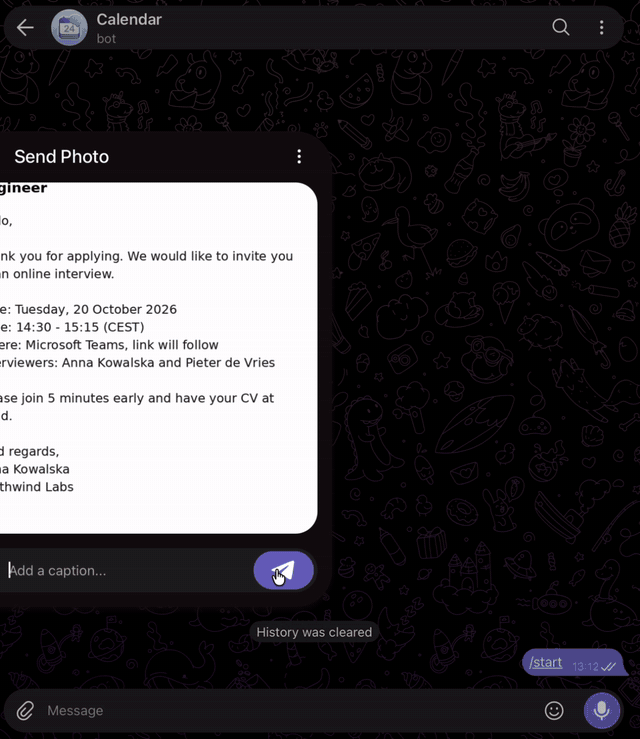
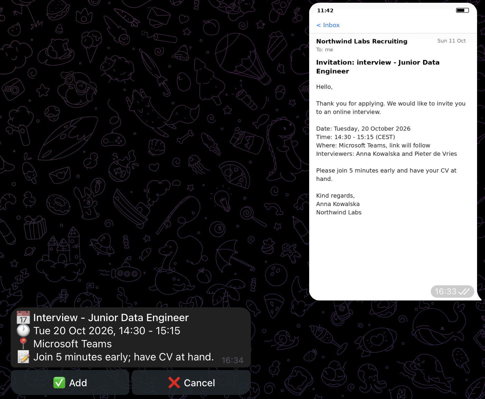
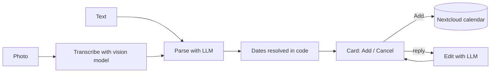
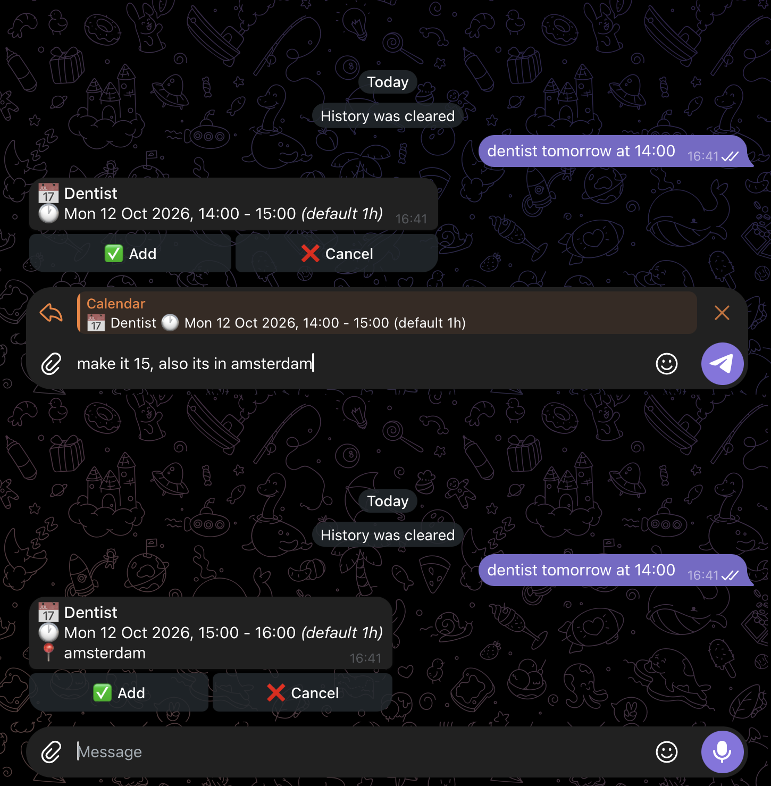
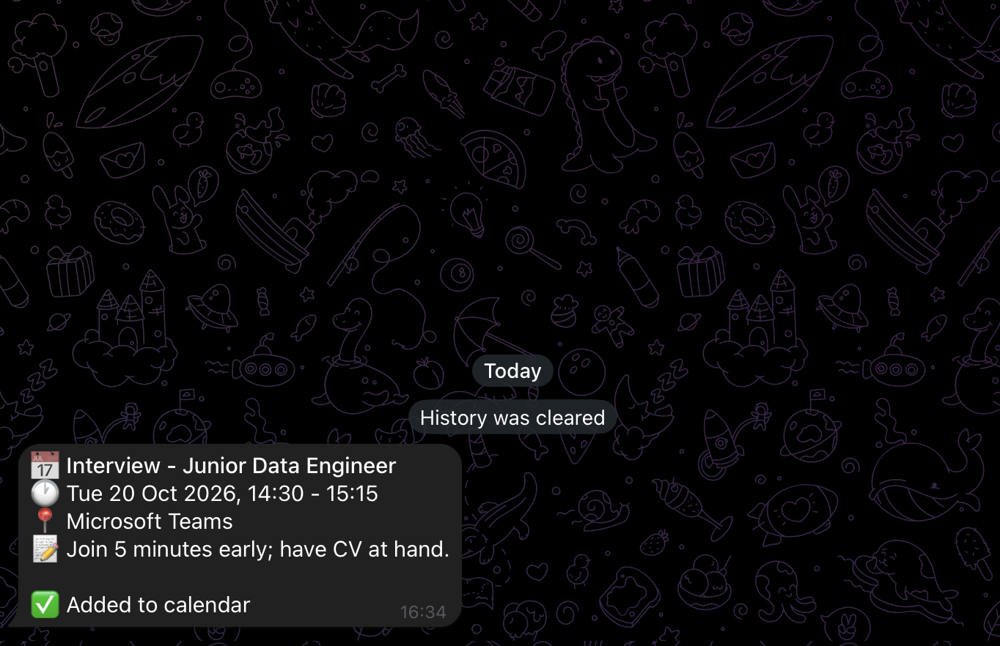
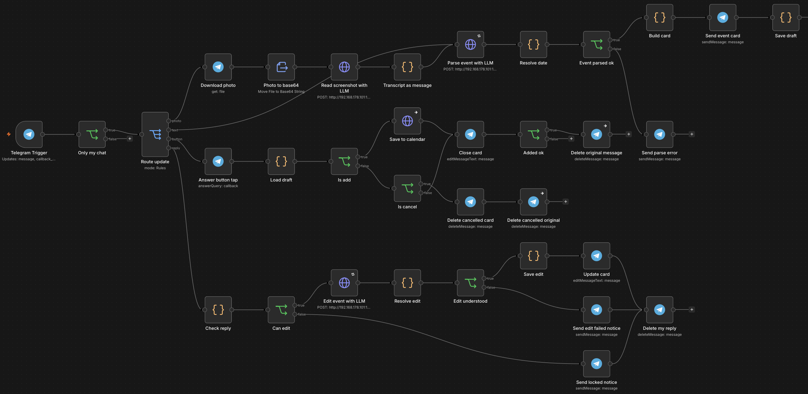

# 📅 n8n Telegram Calendar Bot

A Telegram bot that turns messages and screenshots into calendar events. An event is sent as text or as an image, the bot extracts it with a local LLM, shows a single confirmation card, and saves it to a Nextcloud calendar after one tap.

Runs entirely on self-hosted components: n8n, Ollama and Nextcloud. No cloud AI services are used.

  

## Features

- **Text input** in various languages ("dentist tomorrow 14:00", "kolacja w czwartek o 18:30", "tandarts overmorgen 9:15")
- **Image input**: screenshots and photos of mails, chats, SMS and posters
- **Confirmation card** with ✅ Add and ❌ Cancel. Nothing is saved without confirmation
- **Corrections by reply**: replying to the card with "make it 15:00", "move to friday" or "bring cash" updates the same card
- **Clean chat**: replies and original messages are deleted once processed
- **Local processing**: tested with `qwen3.5:4b` on an RTX 3070 (8 GB)

  

## Mechanics

### Flow

### Date handling

The model does not calculate dates. Small models proved unreliable at it, so the model only describes the date in a fixed English vocabulary and a Code node resolves it.

| `date_kind` | Resolved as |
|---|---|
| `today`, `tomorrow`, `day_after_tomorrow` | today, +1 day, +2 days |
| `weekday` | the next such weekday (today is never counted) |
| `explicit` | the written day and month; without a year, the next occurrence |
| `offset` | today + N days, weeks or months |

If a weekday and a calendar date are both written ("Saturday 24 Oct"), the date is used. When no duration is given, the event lasts one hour and the card shows *(default 1h)*. Dates that cannot be resolved, and dates in the past, produce an error message instead of an event.

### Images

Images are processed in two steps. A vision call only transcribes the visible text, then the same parser used for typed messages extracts the event. Splitting the work was considerably more reliable than extracting the event from the image directly.

### Cards and corrections

Each event has exactly one card. The pending event is stored in workflow static data under the card's message ID.

| Action | Result |
|---|---|
| ✅ Add | Event saved to the calendar, card closed, original message deleted |
| ❌ Cancel | Card and original message deleted |
| Reply to the latest card | Card updated, reply deleted |
| Reply to an older or closed card | 🔒 notice, no change |
| Reply unrelated to the event | 🤷 notice, no change |

A correction request contains only the current event and the new message. There is no conversation history, so the context stays small and responses stay fast. A reply can change the title, date, time, duration or place, add a note ("bring cash"), or remove one. Pending cards expire after 24 hours.

  

  

### Access control

Only the configured chat ID is processed, everything else is dropped. The filter is an `IF` node rather than the trigger's *Restrict to Chat IDs* option, because that option only checks messages and silently drops button presses.

  

## Requirements

- n8n 2.x with a public HTTPS address (Telegram delivers updates through a webhook)
- Ollama with a model that has the `vision` capability
- A Telegram bot token from [@BotFather](https://t.me/BotFather)
- Nextcloud with the Calendar app (CalDAV; only Nextcloud was tested)

## Setup

1. **Bot.** Create a bot with BotFather and keep the token.
2. **n8n.** Set `WEBHOOK_URL` to the public HTTPS address of n8n and restart it.
3. **Model.** `ollama pull qwen3.5:4b`. `ollama show qwen3.5:4b` must list `vision`. If Ollama runs on another host, set `OLLAMA_HOST=0.0.0.0`.
4. **Nextcloud.** Create an app password under *Settings → Security → Devices & sessions*. The workflow writes to the calendar with URL name `personal`. The name is the last part of the link from *Copy private link* in the calendar's menu.
5. **Import** [`workflow/calendar_bot.json`](workflow/calendar_bot.json) via *Import from file*.
6. **Credentials.** Create a *Telegram API* credential (bot token) and a *Nextcloud API* credential (URL, user, app password). Assign Telegram to the trigger and every Telegram node, and Nextcloud to `Save to calendar`.
7. **Placeholders.**

   | Node | Change |
   |---|---|
   | `Only my chat` | `YOUR_TELEGRAM_CHAT_ID` → the numeric chat ID |
   | `Parse event with LLM`, `Edit event with LLM`, `Read screenshot with LLM` | `YOUR_OLLAMA_HOST` in the URL |
   | `Save to calendar` | `YOUR_NEXTCLOUD_HOST` and `YOUR_NEXTCLOUD_USER` in the URL |
   | `Resolve date`, `Resolve edit`, `Check reply`, `Load draft` | time zone `Europe/Amsterdam` |

   The chat ID is shown as `message.chat.id` in the output of the trigger after *Listen for test event* and a message to the bot.
8. **Activate** the workflow. Card state is only persisted for active workflows, so buttons do not work in manual test runs.

## Usage examples

| Input | Result |
|---|---|
| `dentist tomorrow at 14:00` | Tomorrow 14:00 - 15:00 *(default 1h)* |
| `tandarts overmorgen 9:15` | The day after tomorrow, 09:15 |
| `kolacja w czwartek o 18:30` | The next Thursday, 18:30 |
| `Meeting with Anna in 2 weeks at 10, bring the contract` | Today + 14 days, 10:00, note: bring the contract |
| `Saturday 24 oct 21:00 jazz concert at Music House` | 24 Oct, 21:00, location: Music House |
| Reply: `make it 15:00` | Time changed, duration kept |
| Reply: `I need to bring cash` | Note added, rest unchanged |

## Limitations

- Relative dates in screenshots are counted from today, not from the day the message was sent.
- A date without a year resolves to its next occurrence, which may be next year.
- Titles may contain the date or weekday, and the location may repeat the activity. Both can be fixed by replying to the card.
- Only images sent as photos are read, not files. Telegram compresses photos, so small text should be cropped first.
- One event per message.
- If Ollama does not respond, the bot does not reply.
- No reminders are added to events.

## Troubleshooting

| Symptom | Cause and fix |
|---|---|
| No executions at all | Check `https://api.telegram.org/bot<TOKEN>/getWebhookInfo`. An empty `url` means the workflow is inactive or `WEBHOOK_URL` is not set. |
| Messages work, buttons do nothing | *Restrict to Chat IDs* is set on the trigger. Leave it empty and use `Only my chat`. |
| Random hangs | Intermittent IPv6 failures towards `api.telegram.org`. Set `NODE_OPTIONS=--dns-result-order=ipv4first` for n8n. On NixOS, put it in `services.n8n.environment`. |
| "Draft not found" | The card is older than 24 hours, or the workflow only ran manually. Send the event again. |
| "Could not save to the calendar" | The Nextcloud request failed. Check user, app password and calendar URL name in `Save to calendar`. |
| Image gets no answer | The model lacks `vision`, or the first request is still loading it (the vision node waits up to 80 s). |
| "Couldn't read that event" | Inspect `Transcript as message` (images) or `Parse event with LLM` (text) in the execution. |

To check for the IPv6 problem, compare `curl -4` and `curl -6` against `https://api.telegram.org` in a short loop. Failures or long times on `-6` confirm it.

## License

[MIT](LICENSE)
